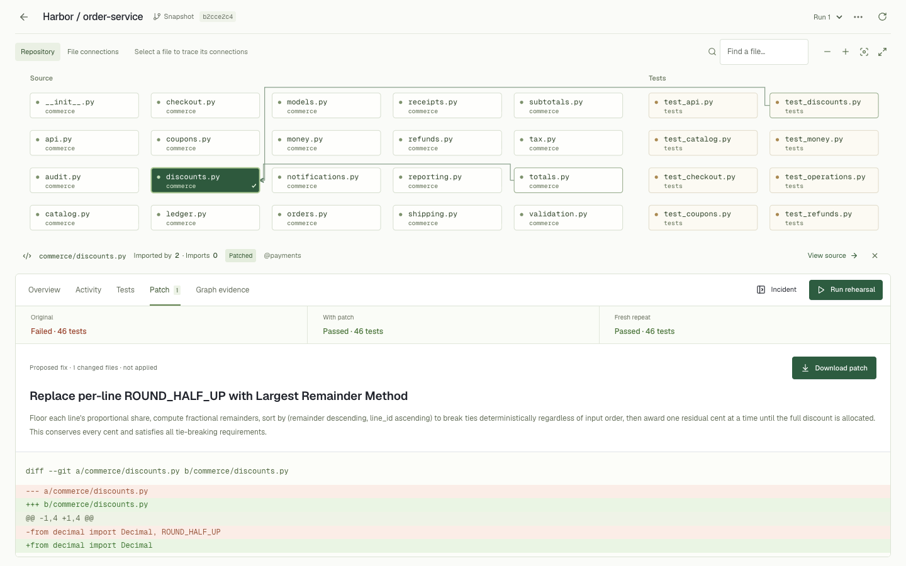
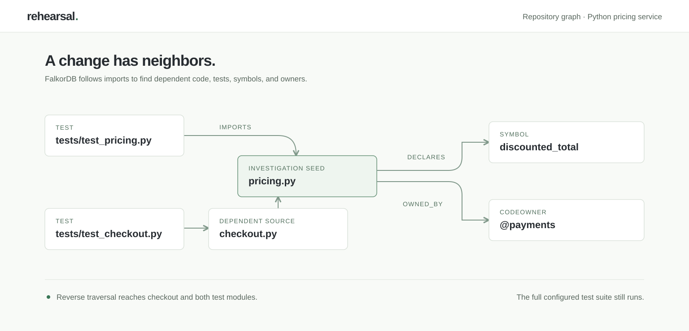
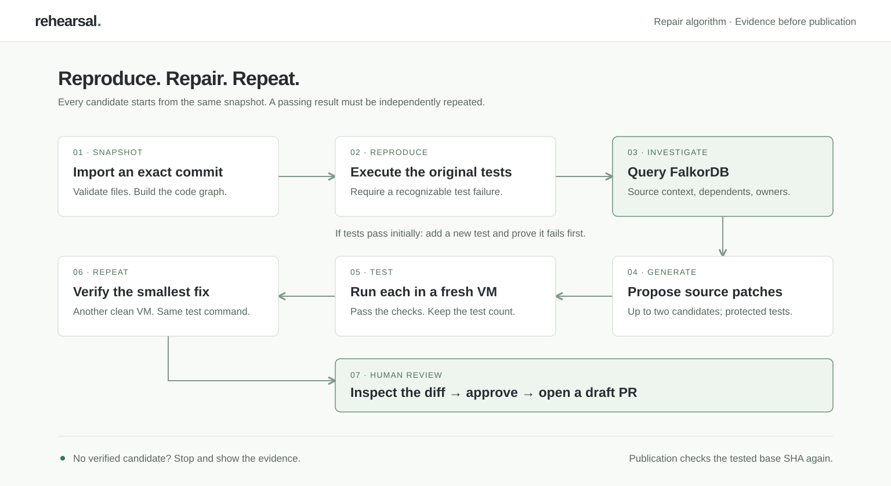

# Rehearsal

Import a GitHub repository or upload a ZIP, describe a bug, and review a patch tested against your code. FalkorDB selects the relevant source files and dependent tests. A Backboard model proposes repairs; isolated sandboxes execute them. A passing patch can be downloaded or published as a draft pull request after review.

<p align="center">
  <a href="docs/screenshots/repository-repair.png">
    
  </a>
</p>

## Use your own code

1. Paste a public GitHub URL, sign in with GitHub to choose an authorized repository, or upload a ZIP. Imports are pinned to an exact commit or content digest. Select a subdirectory for a monorepo.
2. Describe the failure. Review the detected setup and test commands before running them.
3. Run a rehearsal. The original tests run first. If they pass, Rehearsal can add a regression test and must show it failing before attempting a repair.
4. Inspect candidate diffs, executed graph queries, the original failure, and passing test logs. The selected patch must pass a second fresh sandbox run without reducing the reported test count.
5. Download the patch or approve a draft pull request. Publishing requires GitHub write access and rechecks that the base branch still matches the tested commit. Rehearsal does not merge or deploy changes to your application.

Two complete example services require no upload or GitHub account:

| Example | Indexed files / imports | Reproduced failure | Observed verified repair |
| --- | --- | --- | --- |
| Harbor order service · Python | 30 / 38 | Discount rounding breaks checkout, refunds, and ledger reconciliation | One source file; all 46 tests pass twice |
| Atlas event service · Node.js | 28 / 32 | Tied timestamps and imprecise IDs break feeds, exports, and credit replay | Two source files; all 37 tests pass twice |

The dependency map stays visible above **Activity**, **Tests**, and **Patch**. Select a file to trace its direct imports and dependents without drawing every connection at once; **File connections** isolates that neighborhood. Search, zoom, source inspection, and changed-file highlighting are available throughout a run. **Graph evidence** contains the investigation context and executed queries. The incident brief collapses while the run controls remain accessible.

Three smaller starters cover rounding, pagination, and a timeout bug that needs a new regression test. All example repairs are generated at runtime. The earlier [guided operational incident](docs/guided-workspace.md), including its diagrams and policy examples, remains available from **Guided example**.

You can also import the public [Python pricing repository](https://github.com/aman-a-shah/rehearsal-python-example) or [Node event-feed repository](https://github.com/aman-a-shah/rehearsal-node-example). Their default branches intentionally retain the bugs. Real cloud-verified repairs are available as draft PRs: [Python](https://github.com/aman-a-shah/rehearsal-python-example/pull/1), [Node](https://github.com/aman-a-shah/rehearsal-node-example/pull/1).

## Run locally

Requires Python 3.13, Node 22.12+, and Docker Desktop for local repository execution.

```sh
git clone https://github.com/aman-a-shah/rehearsal.git
cd rehearsal
npm run setup
npm run runner:build
```

Set `BACKBOARD_API_KEY` and `REHEARSAL_SANDBOX=docker` in the ignored `.env`, then run:

```sh
npm run dev
```

Open [Rehearsal](http://127.0.0.1:5180). No GitHub OAuth setup is needed for public URL imports or ZIP uploads. Repository repairs use paid model calls; the guided examples remain available without a key.

The local image includes Python, pytest, Node, and npm. Local containers have no network access, including during setup. Projects requiring additional packages need a prebuilt local runner image or the cloud sandbox adapter. The hosted adapter permits npm/PyPI registries during setup and disables outbound traffic during tests.

## How FalkorDB controls the investigation

Each imported snapshot has a separate graph:

<p align="center">
  <a href="docs/diagrams/repository-graph.svg"></a>
</p>

| Nodes / relationship | Evidence represented |
| --- | --- |
| `RepoSnapshot` | SHA-256 digest of imported file contents |
| `RepoFile -[:IMPORTS]-> RepoFile` | Statically resolved local imports |
| `RepoFile -[:DECLARES]-> CodeSymbol` | Symbol name and source line |
| `RepoFile -[:OWNED_BY]-> CodeOwner` | Ownership inferred from CODEOWNERS patterns |
| `RepairRun -[:TESTED]-> RepairCandidate` | Candidate and test outcome |
| `RepairCandidate -[:CHANGES]-> RepoFile` | Files modified by a candidate |

The incident and failing logs identify seed files. FalkorDB retrieves their dependencies:

```cypher
MATCH (s:RepoFile)-[:IMPORTS*0..6]->(f:RepoFile)
WHERE s.path IN $paths
RETURN DISTINCT f.path ORDER BY f.path LIMIT 160
```

It then finds dependent source files and tests:

```cypher
MATCH (f:RepoFile)-[:IMPORTS*0..8]->(s:RepoFile)
WHERE s.path IN $paths
RETURN DISTINCT f.path, f.kind ORDER BY f.path LIMIT 160
```

Ownership and edit eligibility come from subsequent parameterized graph queries. The model receives that source context, failure output, and allowed paths. Changes outside the permitted scope are rejected. A missing or mismatched graph blocks investigation and publication. The complete configured test command runs; the graph is not used to omit regression tests.

Python imports and declarations are parsed with `ast`. JavaScript/TypeScript literal imports and declarations are extracted statically. Computed imports, TypeScript aliases, dependency injection, and complete GitHub CODEOWNERS semantics are not resolved. These relationships are dependency evidence, not measured runtime coverage.

## Repair algorithm

<p align="center">
  <a href="docs/diagrams/repository-algorithm.svg"></a>
</p>

1. **Snapshot:** validate and filter the archive; save an immutable source digest and build its graph. Repository code never executes during import.
2. **Baseline:** run the original setup and test commands in a disposable sandbox and record the actual result.
3. **Investigate:** rank seed files using filenames and incident terms; traverse dependencies, dependents, and ownership in FalkorDB. Bound source context to 100,000 characters. If the original tests passed, generate one new regression test from this context and require it to fail on the original source.
4. **Generate:** request up to two independent source repairs. Apply exact, unique replacements to copies of the original snapshot. Existing tests, dependency manifests, and test/build configuration are protected.
5. **Test:** run each candidate from a clean sandbox. Require successful tests and at least the original reported test count. Prefer fewer changed files, then fewer changed lines, among passing candidates.
6. **Repeat:** rerun the preferred candidate in another fresh sandbox. A failed repeat makes it ineligible; try the next passing candidate or abstain.
7. **Review:** hash the snapshot, commands, changes, and both test results. Require that review digest and an unchanged GitHub base before creating a deterministic repair branch and draft PR. Publication retries recover an already-created PR.

Implementation: [graph extraction and queries](server/repos/codegraph.py), [orchestration](server/repos/service.py), [patch validation](server/repos/patches.py), [sandbox adapters](server/repos/sandbox.py), and [GitHub integration](server/repos/github.py).

## Scope and deployment

This version supports text-based Python and Node.js/TypeScript repositories with self-contained tests. Archives are limited to 12 MB compressed, 24 MB expanded, and 1,800 imported files. Binary files, credential files, links, and files over 512 KB are excluded or rejected. The UI lists excluded files. Tests requiring production secrets, internet services, databases, or an unsupported runtime need a dedicated runner configuration. Passing tests do not establish production correctness.

Deployment uses **Vercel for the website**, **one persistent API container** for accounts, source, queue, and FalkorDB, and **Vercel microVMs** for untrusted code. A Render blueprint is included. See [deployment and GitHub setup](docs/repository-deployment.md).

For temporary judging, [render-demo.yaml](render-demo.yaml) uses Render's free tier and an expiring invitation link. Judges can import a public repository, upload a ZIP, or try an example without signing in. Workspaces reset when the free service sleeps; download patches before leaving. This option needs no hosting subscription and uses the connected model/sandbox allowances.

GitHub OAuth uses state and PKCE. Sessions are opaque, server-stored, and HttpOnly; GitHub tokens are encrypted at rest. Repository endpoints enforce workspace ownership. Provider and GitHub credentials never enter test sandboxes. Persistent quotas reserve usage before execution. See [repository security](docs/repository-security.md).

## Verify

```sh
npm run build
npm test
npm run test:repositories
npm run test:identity
```

`scripts/check-repositories.mjs` checks the browser workflow; its opt-in `REHEARSAL_CHECK_LIVE=1` mode performs paid model calls and real container tests. `scripts/verify-repository-live.py --live` checks public GitHub import, a Node repair, and an uploaded bug requiring a generated regression. `scripts/verify-github-live.py --live` checks cloud execution on the public examples; publication is a separate opt-in step after diff review. See [observed results](docs/verification.md) and the [recording walkthrough](docs/repository-demo.md).

Built with AI assistance. Model suggestions remain unverified until the configured checks and human review complete.
