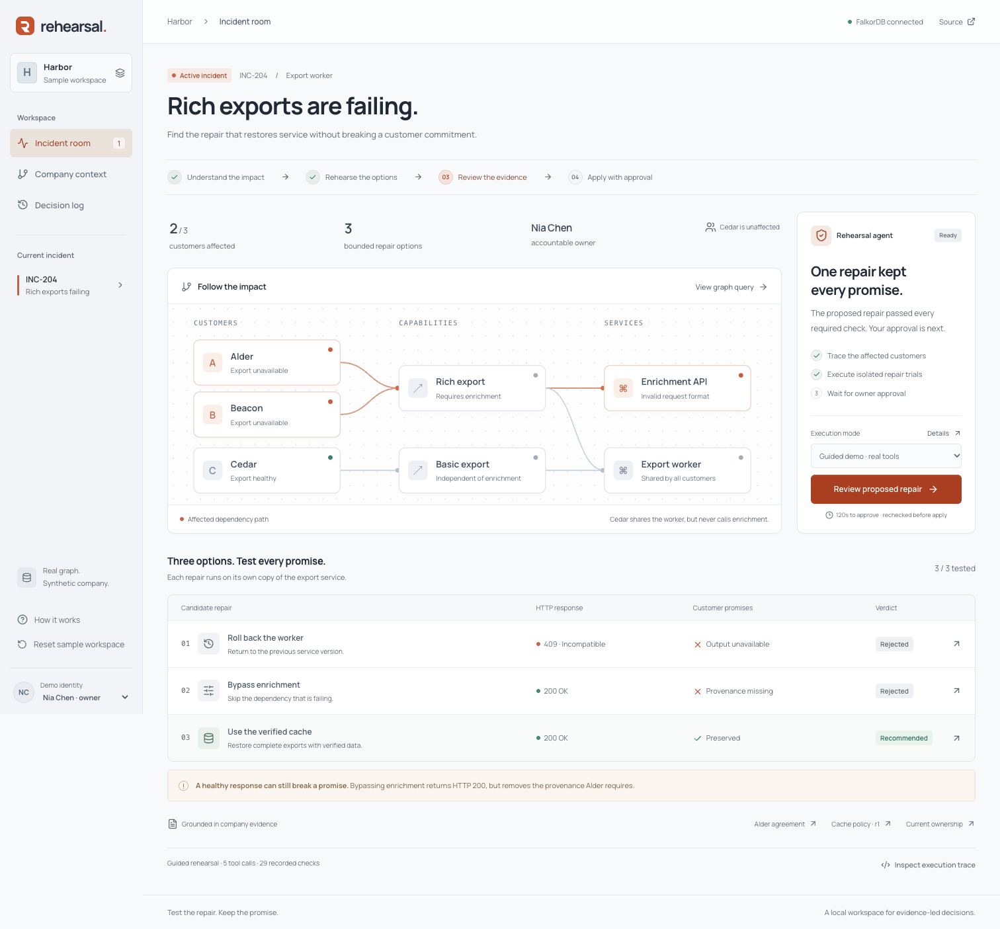

# Rehearsal

**Test the repair. Keep the promise.**

Rehearsal investigates a broken customer export, tests three repairs against a working miniature service, and asks the accountable owner to approve only a repair that preserves the customer's requirements. FalkorDB connects the incident to customer agreements, dependencies, policies, and ownership.

This repository is a rebuild of an earlier personal prototype. Its Git history records the actual rebuild milestones, not the date the original concept or prototype was created. All company data, people, and incidents are synthetic. See [rebuild notes](docs/rebuild.md).



## Run locally

Use Python 3.13 and Node 22.12 or later. The default embedded FalkorDB configuration was exercised on macOS arm64.

```sh
git clone https://github.com/aman-a-shah/rehearsal.git
cd rehearsal
npm run setup
npm run dev
```

Open **http://127.0.0.1:5180**. The API runs at **http://127.0.0.1:8780**. Keep one server process running; the workflow lock is process-local. Stop both development processes with Ctrl+C. Restart after changing Python code or environment variables; the frontend reloads automatically.

The guided demo needs no API key or Docker. It calls the real MCP tools in a fixed sequence, executes three isolated service trials, and stops for human approval. Choose **Reset sample workspace** before a presentation: the synthetic cache begins 12 minutes old and its initial policy allows 15 minutes. A proposed repair expires after two minutes and is tested again when approved.

For the live agent, copy `.env.example` to `.env`, set `ANTHROPIC_API_KEY`, and restart. Select **Live agent** in the incident room. The server calls the Anthropic Messages API; the model chooses the tool calls. The configured default model is listed in the [official model documentation](https://platform.claude.com/docs/en/models/overview). The key stays on the server. Provider failures are shown as errors; they do not silently switch to the guided demo.

To serve the built frontend from the API process:

```sh
npm run build
npm run dev -- --api-only
```

Open http://127.0.0.1:8780 for that configuration. Run either the development pair or the built configuration, since both use API port 8780.

## What the demo proves

The worker sends the wrong request field to an enrichment API. Alder and Beacon's rich exports fail; Cedar's basic export still works. FalkorDB traces those dependencies and supplies the current customer requirements, cache policy, and accountable owner.

| Candidate              | Actual result                                                                        | Decision                   |
| ---------------------- | ------------------------------------------------------------------------------------ | -------------------------- |
| Roll back the worker   | Worker v1 cannot read schema v2; all three exports return HTTP 409                   | Reject                     |
| Bypass enrichment      | Rich exports return HTTP 200, but Alder's required provenance is absent              | Reject                     |
| Use the verified cache | Original report values and required provenance are preserved; cache age meets policy | Propose for owner approval |

The owner approves an evidence-bound proposal. The service commits the change and its receipt in one SQLite transaction, verifies the resulting exports, and records a cited decision and follow-up in FalkorDB. Repeated or concurrent approval requests do not apply it twice.

In **Company context**, propose a 600-second cache limit and accept it as **Policy reviewer**. The old proposal becomes stale. A fresh rehearsal rejects all three options because the cache is now too old. See the [three-minute demo](docs/demo.md) and [architecture](docs/architecture.md).

## Verify

With `npm run dev` running in another terminal:

```sh
npm run build
npm test
npm run test:e2e -- --ui-only
```

The browser suite uses installed Google Chrome by default. To use Playwright's Chromium instead:

```sh
cd web
npx playwright install chromium
cd ..
PLAYWRIGHT_CHANNEL=chromium npm run test:e2e -- --ui-only
```

`npm run test:e2e` runs both backend and browser suites. Browser tests reset the local sample data; use a disposable demo workspace. Screenshots go to ignored `artifacts/`, and failures retain traces in `web/test-results/`. See the [verification record](docs/verification.md).

## Scope

This is a local, synthetic incident simulator with three bounded repairs and one reviewed policy-editing flow. It is not a general incident-remediation service. Demo identities demonstrate ownership checks, not production authentication. The app binds to loopback and is not configured for public hosting or multiple workers.

The graph is real FalkorDB. The export workload uses actual FastAPI handlers and isolated SQLite copies; internal trial HTTP requests use HTTPX's in-process ASGI transport. The external MCP endpoint is http://127.0.0.1:8780/mcp/. It exposes investigation, source reading, trial execution, and recommendation tools; approval remains a separate human action. [Architecture and recovery behavior](docs/architecture.md) describe the boundaries.

State is stored in `.state/`, excluded from Git. A different `REHEARSAL_STATE_DIR` selects a separate local workspace. An optional `FALKORDB_URL` connects to an external server using the `rehearsal_v2` graph; use a dedicated demo graph because resetting the workspace clears it. External FalkorDB and paid live inference were not exercised in the rebuild verification.

The source is AI-assisted. The authors remain responsible for verifying and understanding it. This repository makes no claim that prior work qualifies for any particular competition.
