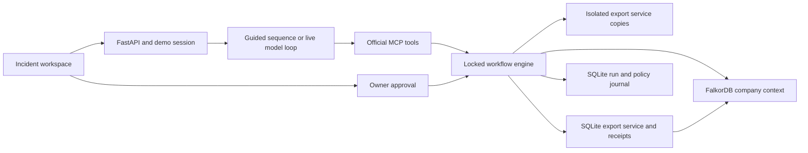

# Architecture

Rehearsal has one Python process, an embedded FalkorDB server, two SQLite databases, and a React client. Development uses Vite's proxy. The production build can be served by FastAPI on loopback.

## Responsibilities

| Module               | Responsibility                                                                           |
| -------------------- | ---------------------------------------------------------------------------------------- |
| `server/seed.py`     | Synthetic company entities, dependencies, source records, and reviewed claims            |
| `server/graph.py`    | Parameterized Cypher, context validation, reviewed policy revisions, and cited decisions |
| `server/workload.py` | Export/enrichment HTTP handlers, isolated trials, and checks against actual output       |
| `server/storage.py`  | SQLite journal, runtime state, atomic compare-and-set mutation with an execution receipt |
| `server/engine.py`   | Evidence snapshots, trial requirements, owner validation, approval expiry, and recovery  |
| `server/agent.py`    | Four official MCP tools, deterministic guided mode, and bounded live provider loop       |
| `server/api.py`      | Local API, opaque demo sessions, origin checks, MCP mount, and static frontend serving   |
| `web/src`            | Three screens, evidence drawers, dependency visualization, and request/polling state     |

## Graph evidence

The affected-customer query follows `USES → IMPLEMENTED_BY → CALLS*0..4 → RUNS_ON` to the failing enrichment service. The worker-footprint query separately includes Cedar, so a worker rollback is tested against a broader scope than the failing dependency.

Active `Claim` nodes link to their supporting `Source` revision. Authoritative agreements, operating policy, and ownership records constrain a repair. Supporting incident/chat records provide context without overriding those facts. Context construction rejects missing or conflicting required claims, invalid values, and unreviewed topology changes. The diagram reads the same stored entities and edges; its layout collapses operation nodes for readability.

A policy edit is structured input. Acceptance replaces the source, supersedes its old revision, changes its active claims, and increments the context revision in one Cypher query. It does not infer new executable policy from arbitrary prose.

## Trials and approval

Each trial backs up the target SQLite database into a temporary directory, changes a candidate configuration there, and calls the actual ASGI HTTP handlers. Checks inspect availability, report identity/amount/currency, required provenance, unaffected-customer output, schema compatibility, and cache policy where relevant.

A proposal binds the repair to the current owner, complete context fingerprint, runtime fingerprint, trial fingerprint, and a two-minute expiry. Only a tested, passing option can be proposed, after all three candidates have been evaluated. Approval checks those bindings, reruns the selected trial, compares output hashes, and performs an atomic target mutation plus receipt insert. The live model has no approval tool.

## Recovery and limits

The service configuration and its receipt share one SQLite transaction. A retry first looks up that receipt; startup reconciles it with the run journal and graph instead of applying the repair again. Graph decision creation is idempotent. A temporary graph-write failure leaves a receipt marked `graph_synced: false`; an approval retry or restart retries that synchronization. A failed output verification is recorded as `needs_review`, not reported as a verified recovery.

Policy acceptance first journals an `applying` state. If its final journal write is interrupted, acceptance can resume by the source's change identifier without incrementing the graph revision twice.

The workflow uses a process-local lock and assumes one API process owns a workspace. This is not distributed transaction coordination with arbitrary external operators. Embedded graph writes are explicitly saved; external graph durability depends on its server configuration. Startup, reset, and the demo identity selector are local simulator mechanisms.

The live provider loop allows at most 12 turns, 24 tool calls, 180 seconds total, 45 seconds per request, and 2,048 output tokens per request. Tool arguments are bound to the server's run ID. The default provider is Anthropic; the official MCP client/server implementation is used for both modes, with in-memory transport internally and Streamable HTTP exposed externally.
