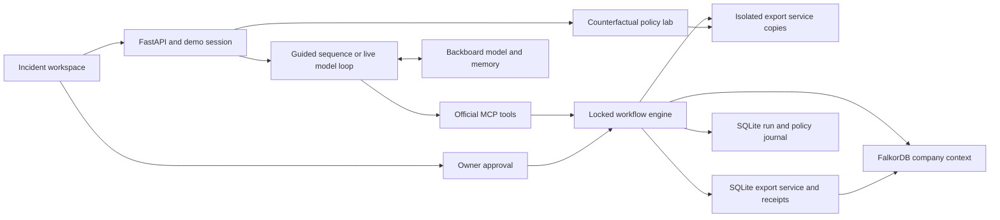

# Architecture

Rehearsal has one Python process, an embedded FalkorDB server, two SQLite databases, and a React client. Development uses Vite's proxy. The production build can be served by FastAPI on loopback.

## Responsibilities

| Module                 | Responsibility                                                                                       |
| ---------------------- | ---------------------------------------------------------------------------------------------------- |
| `server/seed.py`       | Synthetic company entities, dependencies, source records, and reviewed claims                        |
| `server/graph.py`      | Parameterized Cypher, context validation, reviewed policy revisions, and cited decisions             |
| `server/workload.py`   | Export/enrichment HTTP handlers, measured request traces, isolated trials, and output verification   |
| `server/storage.py`    | SQLite journal, runtime state, atomic compare-and-set mutation with an execution receipt             |
| `server/engine.py`     | Evidence snapshots, trial requirements, owner validation, approval expiry, and recovery              |
| `server/agent.py`      | Four official MCP tools, deterministic guided mode, and bounded live provider loop                   |
| `server/backboard.py`  | Stateful Backboard calls, usage budgets, connection validation, and verified outcome memory          |
| `server/simulation.py` | Parallel counterfactual trials and boundary suites on a consistent temporary service snapshot        |
| `server/api.py`        | Local API, opaque demo sessions, origin checks, MCP mount, and static frontend serving               |
| `web/src`              | Incident views, policy lab, connections, searchable evidence, run history, SSE with polling fallback |

## Graph evidence

The affected-customer query follows `USES → IMPLEMENTED_BY → CALLS*0..4 → RUNS_ON` to the failing enrichment service. The worker-footprint query separately includes Cedar, so a worker rollback is tested against a broader scope than the failing dependency.

Active `Claim` nodes link to their supporting `Source` revision. Authoritative agreements, operating policy, and ownership records constrain a repair. Supporting incident/chat records provide context without overriding those facts. Context construction rejects missing or conflicting required claims, invalid values, and unreviewed topology changes. The diagram reads the same stored entities and edges; its condensed layout collapses operation nodes for readability, and Show operations exposes the full paths.

A policy edit is structured input. Acceptance replaces the source, supersedes its old revision, changes its active claims, and increments the context revision in one Cypher query. It does not infer new executable policy from arbitrary prose.

## Trials and approval

Each trial backs up the target SQLite database into a temporary directory, changes a candidate configuration there, and calls the actual ASGI HTTP handlers. Checks inspect availability, report identity/amount/currency, required provenance, unaffected-customer output, schema compatibility, and cache policy where relevant.

Trials also record the baseline and candidate HTTP spans: request identity, parent span, service, method, path, status, body, relative start time, and measured duration. These are instrumentation around the actual local ASGI calls, not imported production telemetry. Detailed traces are journaled with the trial; output hashes still bind the exported result, while the proposal's trial hash binds the complete saved evidence. Approval reruns the output checks without requiring timing measurements to match.

A proposal binds the repair to the current owner, complete context fingerprint, runtime fingerprint, trial fingerprint, and a two-minute expiry. Only a tested, passing option can be proposed, after all three candidates have been evaluated. Approval checks those bindings, reruns the selected trial, compares output hashes, and performs an atomic target mutation plus receipt insert. The live model has no approval tool.

## Recovery and limits

The service configuration and its receipt share one SQLite transaction. A retry first looks up that receipt; startup reconciles it with the run journal and graph instead of applying the repair again. Graph decision creation is idempotent. A temporary graph-write failure leaves a receipt marked `graph_synced: false`; an approval retry or restart retries that synchronization. A failed output verification is recorded as `needs_review`, not reported as a verified recovery.

Policy acceptance first journals an `applying` state. If its final journal write is interrupted, acceptance can resume by the source's change identifier without incrementing the graph revision twice.

The workflow uses a process-local lock and assumes one API process owns a workspace. This is not distributed transaction coordination with arbitrary external operators. Embedded graph writes are explicitly saved; external graph durability depends on its server configuration. Startup, reset, and the demo identity selector are local simulator mechanisms.

The default live provider is Backboard, using `POST /threads/messages` and the explicit `POST /threads/{thread_id}/runs/{provider_run_id}/submit-tool-outputs` continuation endpoint. It receives OpenAI-style function definitions derived from the official MCP schemas. Every continuation resends those schemas: message-scoped tools are not persisted on the automatically created assistant, so the simple continuation endpoint lost the tool list during live verification. The provider's run ID is distinct from the local rehearsal ID.

Backboard responses can repeat previously completed tool calls. A run-local cache binds each tool-call ID to its original function and output, so repeated calls reuse the exact result without executing again or consuming another tool-budget slot. Reusing an ID with different arguments stops the run. The server binds local tool arguments to the current rehearsal and rejects unsupported tools. Overlong recommendations return a correctable tool error rather than silently truncating evidence. Source text and retrieved memories remain evidence, not executable policy. Both guided and live modes invoke the official MCP implementation; external clients use Streamable HTTP.

Backboard runs allow 12 turns, 24 calls, 180 seconds total, 60 seconds per provider request, and 80,000 cumulative reported tokens. The dollar threshold defaults to $1, checked after responses with reported cost; unknown cost is displayed as unknown. No automatic inference retries are issued, avoiding duplicated paid work after ambiguous timeouts. The legacy direct Anthropic path retains its 45-second request timeout and 2,048-token response limit.

## Counterfactual isolation

The policy lab clones the target state and captures company context under the engine lock. It then restores the original injected fault inside that temporary snapshot and applies explicit hypothetical policy and cache-age values. Three workers execute the existing trial verifier against separate clones of this snapshot. One observation timestamp fixes the freshness boundary across all three trials. The result includes its assumptions and `hypothetical: true`; it creates no run, proposal, receipt, or graph change.

The boundary-suite endpoint captures the service and context once, then evaluates fresh, representative, boundary, one-second-over, and older-cache cases with required and optional provenance. Duplicate ages at extreme limits are removed. Every case shares the same observation time and original context fingerprint; every repair runs in its own clone. The default 900-second policy produces 12 scenarios and 36 trials. Results contain the underlying artifacts and are exported directly by the browser without granting any approval authority.

## Progress and memory

`GET /api/runs/{id}/events` streams only changed run records and periodic heartbeats, ending when the investigation reaches a terminal decision. The client falls back to 1.2-second polling if SSE fails. The endpoint reads the lightweight run journal, not the entire company graph.

A successful approval still commits the local repair and receipt first. A separate Backboard memory task records only a verified recovery and its negative evidence. The assistant ID is stored in an integration journal record retained across resets; secrets are not persisted there. Successful memory saves are locally deduplicated. Network ambiguity can still cause a duplicate remote memory on a later explicit retry. Memory failure does not undo a verified recovery. Pending memory tasks finish before the API permits a workspace reset.

Browser-entered API keys are authenticated server-side against Backboard’s assistants endpoint, then held only in the process. This verifies authentication, not model compatibility. Replacing a key clears the remembered assistant ID to avoid using an assistant belonging to another account. The `.env` path supports a persistent key and optional explicit assistant ID. The development runner loads that file without replacing already-set environment variables.

## Public access and examples

`server/security.py` separates opaque operator sessions from the synthetic identity selector. Live investigations, provider configuration, and live approvals require the operator. In public mode, shared workspace writes also require the operator and external MCP is disabled. Anonymous visitors can read the synthetic workspace and execute isolated simulations. The Examples page supplies six explicit scenarios to that same simulation endpoint; it does not store precomputed successes or call a model.

Provider request and live-launch quotas are reserved in `usage.sqlite` before network calls. Atomic SQLite transactions enforce them across concurrent callers, and workspace reset does not clear this database. A launch lock prevents overlapping investigation tasks and connection replacement during execution. Guided approvals never schedule paid memory writes; pending and saved live memories are deduplicated.

An outer ASGI boundary caps mutation bodies, rate limits by peer and aggregate workload, and holds concurrency slots for simulations and event streams until their responses finish. Validation errors omit submitted values. Public deployments use exact host/origin allowlists and HTTPS cookies. These controls assume one API worker with persistent state. [Security](security.md) documents limits and the separate provider-account billing boundary.
