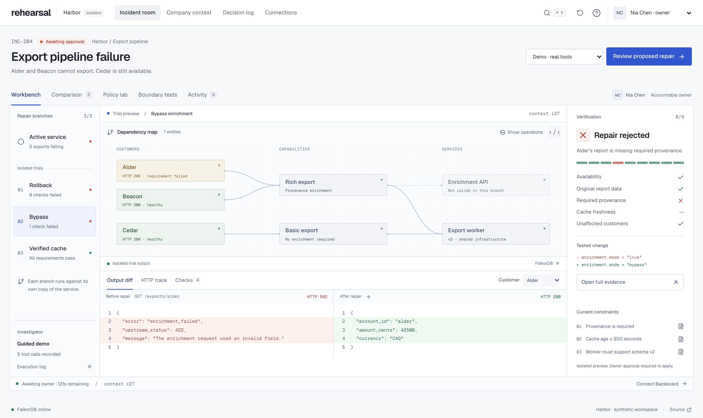
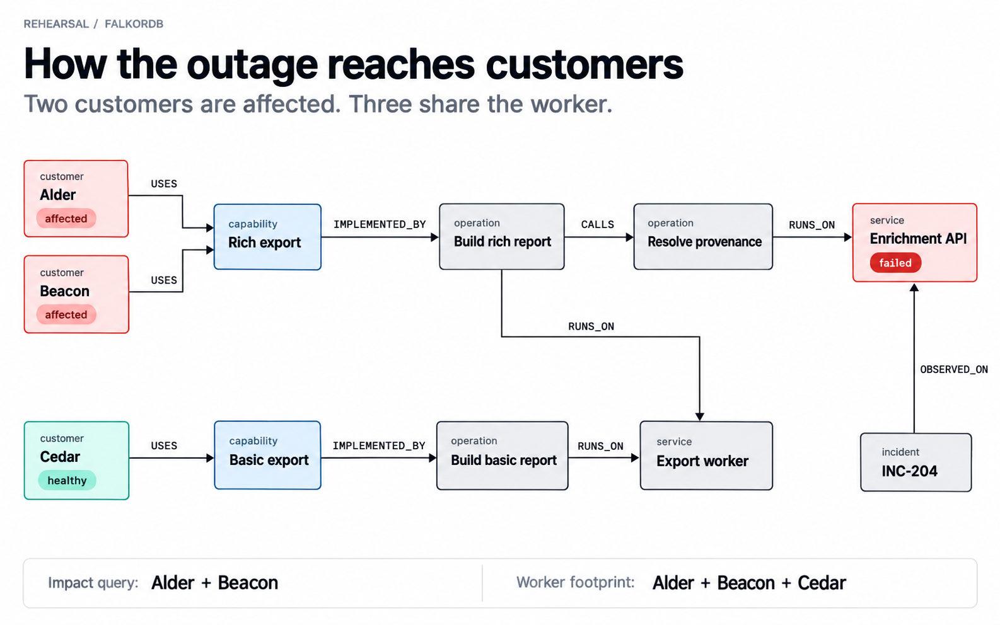
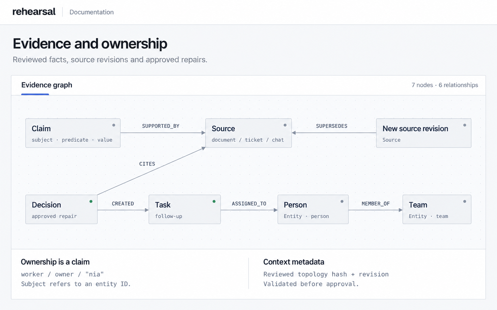
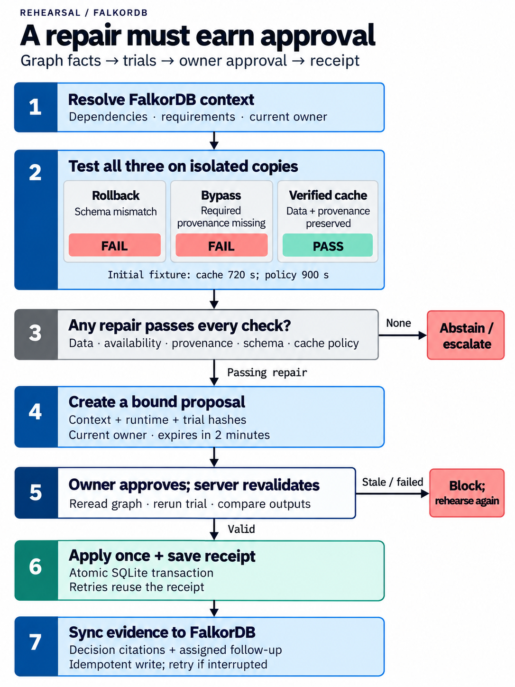

# Guided incident workspace

This is the original fictional Harbor workspace. For real repository repairs, see the [main README](../README.md).

The guided workspace tests incident repairs against customer requirements. A Backboard agent reads dependencies and reviewed facts from FalkorDB, runs three repairs on isolated service copies, and proposes a passing option for owner approval.

<p align="center">
  <a href="../docs/screenshots/workbench.png">
    
  </a>
</p>

## Try it

Requires Python 3.13 and Node 22.12+. Tested on macOS arm64.

```sh
git clone https://github.com/aman-a-shah/rehearsal.git
cd rehearsal
npm run setup
npm run dev
```

Open [Examples](http://127.0.0.1:5180/#examples). Six cases execute real HTTP trials and checks without a key: required provenance, a stricter freshness policy, optional provenance, the exact freshness boundary, expired cache, and two passing repairs. Each includes output inspection and downloadable evidence.

For the complete approval flow, select **Demo · real tools** in the incident room and click **Run rehearsal**. Reset first: this mode uses the current clock. For model-driven tool selection, [configure operator access and Backboard](../docs/development.md#backboard), then select **Backboard agent**.

## The incident

Harbor's enrichment API rejects a malformed request. Alder and Beacon cannot export; Cedar still can. Three repairs are available:

| Repair         | Observed result                                                                  |
| -------------- | -------------------------------------------------------------------------------- |
| Rollback       | The older worker cannot read the current schema. All three exports fail.         |
| Bypass         | Exports return HTTP 200, but Alder's required provenance is missing.             |
| Verified cache | Preserves report data and provenance while the cache meets the freshness policy. |

Only a passing repair can be proposed. Approval rechecks the evidence and output, applies the change once, and saves a receipt. In live mode, verified recoveries are saved to Backboard memory for later investigations.

## How the agent uses FalkorDB

The agent calls four MCP tools: `inspect_context`, `read_source`, `rehearse_repair`, and `recommend_repair`. These invoke fixed, parameterized Cypher and the trial verifier. The model cannot approve a change or execute arbitrary Cypher.

### Nodes and relationships

The dependency map uses `Entity` nodes with a `kind` of `customer`, `capability`, `operation`, `service`, or `incident`. Arrows show stored relationships:

<p align="center">
  <a href="../docs/diagrams/dependency-graph.png">
    
  </a>
</p>

Company evidence and completed decisions use these stored relationships:

<p align="center">
  <a href="../docs/diagrams/evidence-graph.png">
    
  </a>
</p>

`Claim` stores `subject`, `predicate`, and a JSON-encoded `value`; for example, `alder / requires_provenance / true` and `worker / owner / "nia"`. Subjects refer to entity IDs by property. Active claims must point to a current source; authoritative sources supply the required policy and ownership facts. A `Context` node stores the reviewed topology hash and revision. See the [seed records](../server/seed.py) and [graph implementation](../server/graph.py).

### Queries that control the repair

The impact query follows customer dependencies to the failed service. With `$failed = "enrichment"`, it returns Alder and Beacon:

```cypher
MATCH (a:Entity {kind:'customer'})-[:USES]->(c:Entity)
-[:IMPLEMENTED_BY]->(o:Entity)-[:CALLS*0..4]->(d:Entity)
-[:RUNS_ON]->(:Entity {id:$failed})
RETURN DISTINCT a.id, c.id, o.id, d.id ORDER BY a.id
```

The worker-footprint query also returns Cedar. A rollback must therefore preserve all three customers' exports:

```cypher
MATCH (a:Entity {kind:'customer'})-[:USES]->(:Entity)
-[:IMPLEMENTED_BY]->(:Entity)-[:RUNS_ON]->(:Entity {id:'worker'})
RETURN DISTINCT a.id ORDER BY a.id
```

Requirements come from active claims and their current supporting sources:

```cypher
MATCH (c:Claim {active:true})-[:SUPPORTED_BY]->(s:Source {current:true})
RETURN c.subject, c.predicate, c.value, s.id, s.authoritative ORDER BY c.id
```

Alder's provenance claim rejects bypass despite HTTP 200. Accepting a cache-policy revision from 900 to 600 seconds makes the sample's 720-second cache ineligible. Missing, conflicting, or unavailable graph context blocks new approvals.

### Graph functions

Implemented in [server/graph.py](../server/graph.py):

| Function | Work performed |
| --- | --- |
| `context()` | Validates the topology hash; resolves current claims; returns affected paths, worker footprint, owner, source revisions, and a context fingerprint. |
| `source_list(history)` | Reads current sources or their revision history. |
| `diagram()` | Reads stored entity nodes and edges for the dependency map. |
| `accept_policy(change)` | Checks expected revisions, supersedes the old source, replaces active claims, and advances the context revision in one Cypher write. |
| `record_decision(receipt)` | Uses `MERGE` to store a decision, source citations, and an assigned follow-up task without duplicating them on retry. |

### Algorithms and execution

<p align="center">
  <a href="../docs/diagrams/repair-algorithm.png">
    
  </a>
</p>

1. **Resolve context.** Traverse at most four `CALLS` edges to the failing service. Deduplicate affected customers. Query the worker footprint separately so rollback also checks Cedar. Required authoritative facts must each resolve to one value.
2. **Evaluate candidates.** Back up SQLite into a temporary database for each repair, change its configuration, and call the actual ASGI export handlers. Check availability, original account/amount/currency, required provenance, schema, unaffected customers, and `0 ≤ cache_age ≤ policy_limit`. Eligibility is the conjunction of all checks.
3. **Recommend.** All three candidates must be tested first. The server accepts only a passing repair or an abstention. Guided runs and simulations prefer cache, then bypass, then rollback. The live agent receives that preference in its prompt; the verifier enforces eligibility.
4. **Bind approval.** SHA-256 hashes of canonical JSON bind the context, runtime, trial evidence, owner, and a two-minute expiry. Approval rereads the graph, reruns the selected trial, and compares output hashes.
5. **Apply once.** A SQLite `BEGIN IMMEDIATE` transaction compares the current runtime hash, changes the service, and inserts a receipt. Retries reuse that receipt. Decision/task synchronization to FalkorDB is retried after an interrupted write.

The [counterfactual evaluator](../server/simulation.py) captures one service snapshot and observation time, then evaluates the three repairs on separate copies using three worker threads. Examples do not create proposals or edit graph policy. The default boundary suite evaluates 12 scenarios and 36 trials, including cache ages of 900 and 901 seconds.

The [workflow engine](../server/engine.py) and [HTTP verifier](../server/workload.py) implement these checks. [Architecture](../docs/architecture.md) covers recovery and provider behavior.

## Public demo controls

Paid actions require an operator session. Default rolling quotas allow 3 live runs/hour, 6/day, and 60 provider requests/day across the workspace, including connection checks and memory writes. Quotas are reserved before requests and survive workspace resets and restarts. Guided runs and examples make no provider calls.

Public mode restricts shared-state changes to the operator and disables external MCP. API requests have rate, body-size, and concurrency limits. Validation errors omit submitted values; keys are excluded from responses, journals, browser storage, and the repository. See [security and deployment](../docs/security.md) for configuration and limits.

## Development

React/TypeScript provides the interface; FastAPI serves the API and local export service. FalkorDB stores company context. SQLite stores service state, trial journals, receipts, and usage quotas.

```sh
npm run build
npm test
```

See [development and browser tests](../docs/development.md), [container deployment](../docs/deployment.md), the [demo video plan](../docs/demo.md), and [verification results](../docs/verification.md).

This is a local simulator with fictional company data and three predefined repairs. Demo identities are not production authentication. The project uses AI-assisted code.
